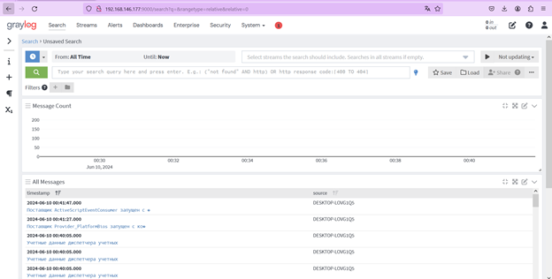
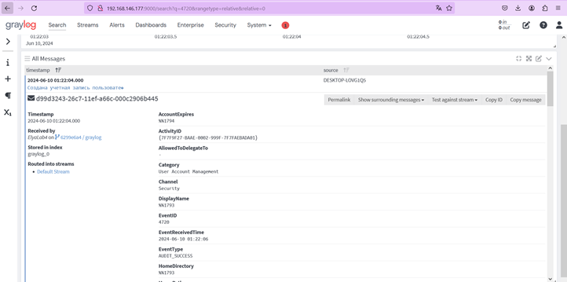
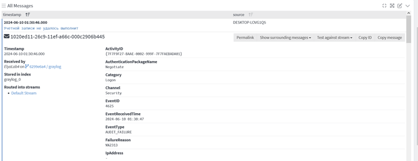

# Graylog SIEM Log Monitoring Lab
**PRACTICAL SIEM LOG MONITORING LAB USING GRAYLOG AND NXLOG.**

**Project overview**

In this laboratory project, I installed and configured **Graylog** on an Ubuntu virtual machine and set up **NXLog** on a Windows PC to forward Windows event logs to the Graylog server.

I configured log collection and monitoring, then generated and investigated Windows security events related to user account creation, password changes, failed authentication, and user account deletion. I verified that these events appeared in the Graylog **Search** section.

# Screenshots

Windows security events in Graylog

User account creation (Event ID 4720)

Failed authentication (Event ID 4625)

### Other important information

For more details about the project, configuration steps, and results, see the [laboratory report](Report.pdf).
